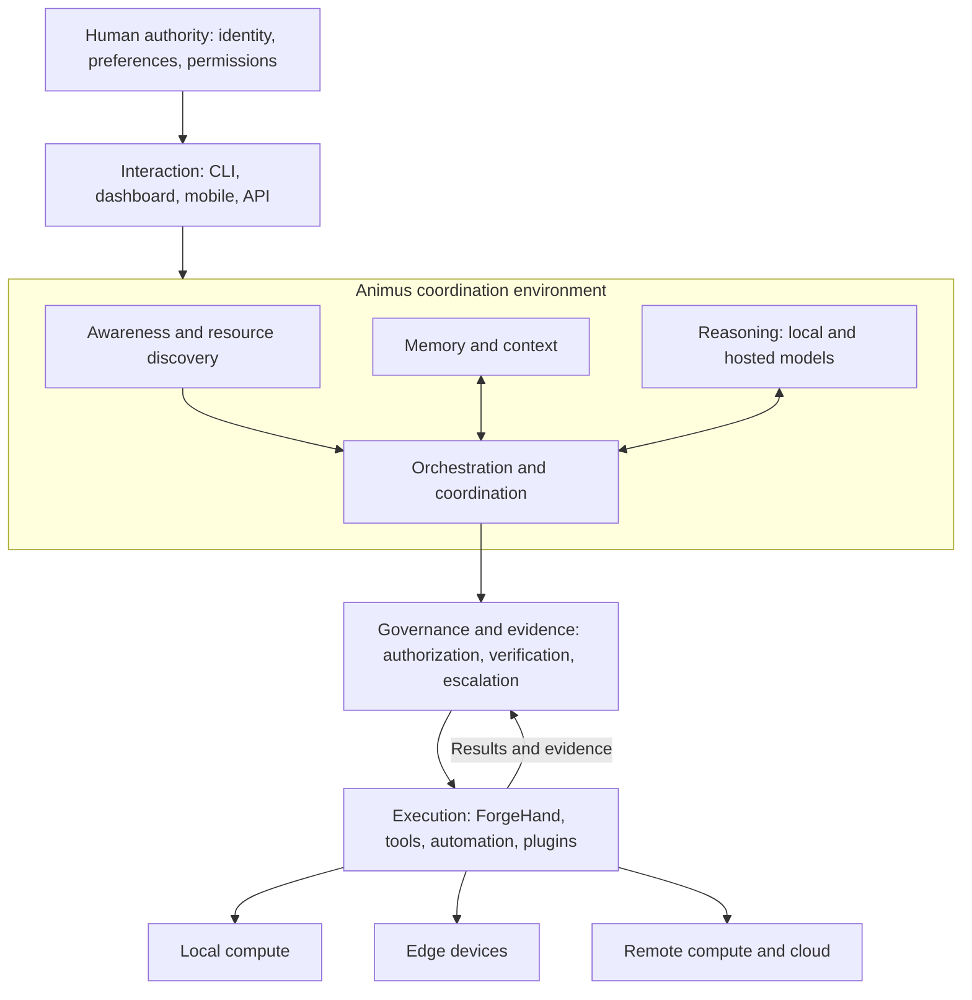

# Animus — An Intelligent Computing Environment You Own

**Local-first AI infrastructure for modular, governed, and interoperable intelligent systems.**


[](https://pypi.org/project/convergentAI/)


Animus is an open-source project exploring how intelligence can become a capability of a computing environment rather than a feature confined to an individual application.

Today, Animus provides a personal AI assistant, persistent memory, multi-agent workflow orchestration, coordination, and operational interfaces. These are the foundations of a broader architecture, not a claim that the complete vision has been realized.

**Platform:** Linux is the current implementation and supported public deployment target. Broader operating-system and hardware independence are long-term objectives, not current compatibility guarantees.

[Architecture](docs/architecture/overview.md) | [Roadmap](docs/roadmap/current.md) | [Getting Started](docs/getting-started/quickstart.md) | [Tools Reference](docs/reference/tools.md)

## North Star

Animus aims to enable a personal, local-first intelligent computing environment in which awareness, memory, reasoning, orchestration, governance, and execution are modular, interoperable capabilities.

Drawing from ambient intelligence, edge AI, distributed computing, and agent systems, the project explores how these capabilities can cooperate across heterogeneous hardware and software while preserving human authority.

The objective is not to build another operating system, replace existing tools, or maximize autonomous behavior. It is to make existing and emerging capabilities work together within an environment that individuals can own, understand, customize, and control.

An intelligent environment should be able to recognize when intelligence is needed, select appropriate resources, and operate within explicit permissions. Conventional monitoring, deterministic automation, local inference, and hosted models can all have a place in that environment.

Linux is the current foundation. Model, hardware, device, operating system, and framework independence are architectural objectives.

## Architectural principles

| Principle | Meaning |
|---|---|
| Local-first | Prefer locally controlled resources where practical; external services remain an explicit choice. |
| Model agnostic | Treat models as interchangeable capabilities through defined interfaces. |
| OS and hardware agnostic | Minimize platform coupling and accommodate heterogeneous resources over time. |
| Device agnostic | Aim for continuity across interaction surfaces. |
| Tool agnostic | Integrate existing tools before building replacements. |
| Modular | Keep components independently useful and replaceable. |
| Deterministic first | Use conventional software when inference is unnecessary. |
| Human authority | Capability does not imply permission; preserve approval, escalation, and intervention. |
| Observable | Make actions, decisions, failures, and resource consumption inspectable. |
| Recoverable | Preserve state and enable controlled recovery. |
| Resource aware | Operate within computational and financial constraints. |
| Consolidate before expanding | Prove existing workflows before adding infrastructure or capabilities. |

## Target architecture

The following diagram describes the **North Star**, not a deployed topology or a replacement for the current package architecture.



Animus coordinates capabilities rather than requiring that every capability be implemented inside Animus. Governance and execution are distinct responsibilities: an executor cannot grant itself authority or decide unilaterally that its work is acceptable.

Environmental awareness, automatic resource discovery, portable distributed execution, and cross-device continuity are target capabilities. The diagram does not imply that they are available end to end today.

## Current implementation

The repository contains the following packages. Their maturity varies; see the linked package documentation and release evidence for details.

| Package | Responsibility |
|---|---|
| [core](packages/core/) | Personal AI assistant, identity, memory, CLI, integrations, MCP server, inference dispatch |
| [forge](packages/forge/) | Workflow orchestration, agent budgets, quality gates, stage persistence |
| [quorum](packages/quorum/) | Intent-graph coordination and voting, with optional Rust backend |
| [kernel](packages/kernel/) | Builder engine and memory/storage abstractions |
| [bootstrap](packages/bootstrap/) | Daemon, onboarding, dashboard, operational interfaces |
| [pwa](packages/pwa/) | React/Vite interface; functional but early |
| [contracts](packages/contracts/) | Canonical schemas and validation |
| [types](packages/types/) | Shared cross-package types |

The current conceptual architecture and package architecture describe different views of the system. See [Architecture Overview](docs/architecture/overview.md) for the documented six-layer model and [Package Architecture](docs/architecture/packages.md) for component boundaries.

## Citizens in Action

Autonomous improvement proposals generated from codebase observation:


---

## Core Design Decisions

These are visible in the code, not aspirational:

- **Stage persistence by default** — Every Forge workflow records stage inputs, outputs, and status to SQLite. You can manually restart execution at any prior step index. Automatic crash recovery that rehydrates full context from a prior run is implemented in the checkpoint store but not yet wired end-to-end in the executor. The state machine is in `packages/forge/src/animus_forge/executor.py`.
- **Token budgets per agent** — Every agent declaration includes a `budget` field. The executor enforces it. Budgets help bound token consumption; actual provider costs depend on configuration and usage. See `packages/forge/workflows/*.yml` for examples.
- **Quality gates before merge** — Deterministic scoring (tool/completeness/structure) with adversarial test harness. Configured gates evaluate workflow outputs against defined criteria. Implemented in `packages/forge/src/animus_forge/gates/`.
- **Provider-agnostic dispatch** — LLM calls go through a shared interface. Swap Claude for OpenAI or Ollama without touching agent code. Native tool use dispatches by provider. See `packages/core/animus/inference/`.
- **Local-first memory** — Core stores episodic, semantic, and procedural memory
  in local JSON by default. Deployments can configure the durable SQL backend
  after completing its setup. Legacy Core Chroma data requires the documented
  migration process and is not opened by the supported runtime.

---

## Prerequisites

- Python 3.11+
- Node.js 18+ (for PWA build)
- Docker (optional, for PostgreSQL)
- Ollama (optional, for local LLM inference)

## Quickstart

### First-Time User (5 minutes, no API keys)

The fastest way to verify Animus works on your machine:

```bash
git clone https://github.com/Arete-Consortium/animus && cd animus
pip install -e packages/types/ -e "packages/core/[dev]" -e packages/kernel/ -e packages/contracts/
python -c "import animus; print('OK — version', animus.__version__)"
export ANIMUS_CITIZENS_CODEBASE_PATH="$(pwd)"
python -m animus.cli architect --focus codebase
```

You should see a scan of the repository and a generated improvement proposal with an `ADL-` ID. No API keys required — the Architect Citizen uses local static analysis.

> **Full walkthrough:** See [`docs/user-scenarios/v2.3-first-run.md`](docs/user-scenarios/v2.3-first-run.md) for troubleshooting and next steps.

### Full Stack (dashboard + PWA)

```bash
git clone https://github.com/Arete-Consortium/animus && cd animus
pip install -e packages/bootstrap/ -e packages/kernel/ -e packages/core/ -e packages/contracts/
cd packages/pwa && npm install && npm run build && cd ../..
animus-bootstrap serve
# Open http://localhost:7700/pwa/ on the host; configure authorized remote access separately.
```

### PostgreSQL (optional, recommended for production)

```bash
cp infra/.env.example infra/.env   # fill in credentials
docker compose -f infra/docker-compose.yml up -d
export ANIMUS_DATABASE_URL=postgresql://...   # from your .env
python scripts/setup_postgres.py
animus-bootstrap serve
```

### Run the CLI

```bash
python -m animus  # Interactive agent with memory, tools, streaming
```

### MCP Server (Claude Code integration)

```bash
pip install animus[mcp]
python -m animus.mcp_server  # 10 tools: memory, tasks, workflows, self-improve
```

Add to `~/.claude/mcp.json`:
```json
{
  "mcpServers": {
    "animus": {
      "command": "python",
      "args": ["-m", "animus.mcp_server"]
    }
  }
}
```

---

## Usage

### Define a workflow in YAML

```yaml
# workflows/code-review.yml
name: code-review
agents:
  - role: researcher
    model: claude-sonnet-4-20250514
    budget: 4000
    task: "Analyze the codebase structure and identify patterns"
  - role: reviewer
    model: claude-sonnet-4-20250514
    budget: 8000
    task: "Review code for correctness, security, and maintainability"
    depends_on: [researcher]
gates:
  - after: reviewer
    check: quality_score >= 0.8
```

### Run it

```bash
# Via CLI
cd packages/forge
animus-forge run workflows/code-review.yml

# Via API (Forge runs as a systemd service on port 8000)
curl -X POST http://localhost:8000/api/v1/workflows/run \
  -H "Content-Type: application/json" \
  -d '{"workflow": "code-review", "params": {"target": "./src"}}'
```

### Use Quorum for agent coordination

```python
from convergent import Intent, IntentGraph

graph = IntentGraph()

# Two agents register their intents
graph.register(Intent(
    agent_id="researcher",
    action="analyze",
    provides=["codebase_map"],
    stability=0.9
))
graph.register(Intent(
    agent_id="reviewer",
    action="review",
    requires=["codebase_map"],
    stability=0.7
))

# Find conflicts and resolve them without a supervisor
overlaps = graph.find_overlapping(agent_id="reviewer")
```

### Self-Improvement

Animus can analyze and improve its own codebase:

```bash
# CLI: analyze and improve
cd packages/forge
animus-forge self-improve run --provider ollama --path /path/to/project

# Analyze only (no changes)
animus-forge self-improve analyze --focus security

# Record feedback for the reflection loop
animus-bootstrap feedback add up -m "Good response" -c "Accurate and concise"
animus-bootstrap feedback add down -c "Wrong answer, hallucinated API"

# Trigger reflection (reads feedback, updates LEARNED.md)
animus-bootstrap reflect

# View feedback stats
animus-bootstrap feedback stats
```

The self-improve pipeline: analyze → plan → safety check → sandbox test → apply → create PR. Human approval gates at every critical stage. Automatic rollback on test failure.

---

## Ecosystem

These projects are complementary, independently useful capabilities. Listing a project here does not imply that its integration into Animus is complete.

- **[ForgeHand](https://github.com/AreteDriver/Forgehand-public)** — Governed software-engineering execution environment; public architectural overview, private implementation.
- **Loop Governor** — Standalone governance boundary for task authority, scope, evidence, budgets, escalation, and completion decisions.
- **[Memboot](https://github.com/AreteDriver/memboot)** — Earlier exploration of persistent local AI memory; archived repository.
- **[mcp-manager](https://github.com/AreteDriver/mcp-manager)** — MCP server management.
- **[ai-spend](https://github.com/AreteDriver/ai-spend)** — Cross-provider AI cost aggregation.
- **[The Human Stack](https://github.com/AreteDriver/the-human-stack)** — Evidence and governance methodology.

## Development priorities

### Near term — Consolidation

- Stabilize existing runtime services and validate end-to-end workflows.
- Clarify governance and execution ownership; integrate existing tools where appropriate.
- Improve operational observability, local inference reliability, and delegated execution.
- Reuse existing infrastructure and establish evidence of reliable operation before expanding.

### Medium term — Interoperability

- Explore capability registration, resource discovery, and distributed workload routing.
- Improve context continuity and lightweight environmental monitoring.
- Define narrow interfaces for independently developed modules and tools.

### Long term — Intelligent environments

- Explore heterogeneous edge computing and hardware-independent deployment.
- Investigate context-aware assistance and governed adaptation.
- Enable highly customizable AI-native computing environments across devices and platforms.

These are directional priorities rather than release commitments. The [roadmap](docs/roadmap/current.md) documents earlier milestones and should be read with its dated build baseline in mind.

## Development and verification

Animus is actively developed using AI-assisted engineering with human oversight and review. Automated tests, linting, schema checks, security checks, and evidence requirements support verification. Exact test totals and package versions should be sourced from current CI and package metadata rather than static README estimates.

## Research and collaboration

Animus explores the intersection of ambient intelligence, edge AI, distributed systems, persistent memory, and governed agent infrastructure.

Questions motivating this work include:

- What is the minimum amount of inference needed for a useful intelligent environment?
- How should awareness, reasoning, memory, execution, and authority be separated?
- How can independent capabilities cooperate across devices without compromising privacy or human control?
- How can an environment evolve without requiring its owner to rebuild it around each new model or platform?

Technical feedback, research discussions, and contributions are welcome.

- [Writing and research](https://aretedriver.substack.com)
- [Discord community](https://discord.gg/fdzQkrt8)

## Documentation

- [Getting Started](docs/getting-started/quickstart.md) — Install and first steps
- [Architecture](docs/architecture/overview.md) — System design and layers
- [Packages](docs/packages/) — Per-package docs and version matrix
- [Contributing](docs/contributing/setup.md) — Dev environment and workflow
- [Operators](docs/operators/deployment.md) — Deploy, configure, monitor
- [Reference](docs/reference/glossary.md) — Glossary, FAQ, security
- [Roadmap](docs/roadmap/current.md)
- [Whitepaper (PDF)](docs/whitepaper.pdf)
- [Whitepapers (Markdown)](docs/whitepapers/)

---

## License

MIT
