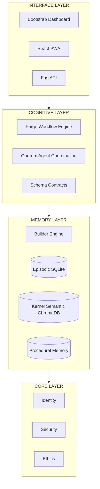
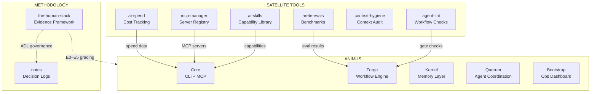

# Animus — AI Operating Environment You Own

**Multi-agent orchestration framework with budget controls, quality gates, and stage persistence.**


[](https://pypi.org/project/convergentAI/)


Running AI agents in production creates three predictable failures: **costs spiral** because no one tracks token spend, **pipelines break halfway through** and restart from scratch wasting compute, and **multi-agent systems bottleneck** on a single supervisor that burns tokens just watching. Animus fixes this with manufacturing-line discipline — every agent gets a token budget, every workflow persists stage inputs and outputs to SQLite for manual restart on failure, and agent coordination uses shared intent graphs instead of a central supervisor.

Before software I spent 17 years in manufacturing and logistics (IBM, Toyota Production System). The same principles apply here: make cost visible, make waste impossible to ignore, stop and fix before propagating errors.

**Platform: Linux only** for the public open-source launch. macOS support is on the roadmap; Windows is out of scope.

Eight packages (four installable via PyPI). Test corpus: ~13,500 unit/integration tests across packages, plus ~1,800 internal coverage-ratchet tests. Proactive engine with 6 self-healing checks and an autonomous improvement loop verified end-to-end against local inference.

> **Development method:** Built with Claude Code (human-reviewed, human-verified). See [profile](https://github.com/AreteDriver) for the full transparency note.

**[Architecture](docs/architecture/overview.md)** | **[Roadmap](docs/roadmap/current.md)** | **[Whitepaper](docs/whitepaper.pdf)** | **[Tools Reference](docs/reference/tools.md)**

---

## Citizens in Action

Autonomous improvement proposals generated from codebase observation:


---

## The Architecture

Four-layer stack. Each layer solves exactly one problem and is independently useful.



**Package map**:
- `bootstrap` → FastAPI dashboard + HTMX UI + PWA static host
- `pwa` → React 19 + Vite PWA calling `/api/*` endpoints
- `forge` → Workflow orchestration engine
- `quorum` → Decentralized agent coordination (`convergent` on PyPI)
- `contracts` → Canonical JSON schemas with runtime `jsonschema` validation
- `kernel` → Autonomous builder engine + `MemoryLayer` with PostgreSQL/SQLite/ChromaDB backends
- `core` → Personal AI assistant + CLI + MCP server
- `types` → Shared cross-package type definitions

---

## Ecosystem

Animus does not exist in isolation. These are the tools that feed it, manage it, or extend it — each independently installable.



---

## Further Reading

The philosophy behind Animus is documented in essays, not just code:

- **[From 700 Pints to 4,800 Per Hour](https://aretedriver.substack.com)** — How manufacturing discipline (Toyota Production System, Kaizen, error-proofing) maps to AI operations. This is the origin story of checkpoint/resume, token budgets, and quality gates.
- **[The Eval Is the Product](https://aretedriver.substack.com)** — Why Animus treats evaluation infrastructure as a first-class subsystem (Forge + arete-evals) rather than an afterthought.
- **[The Human Stack](https://github.com/AreteDriver/the-human-stack)** — The full methodology reference: evidence grading (E0–E5), ADL governance, failure taxonomy, and benchmark standards.

---

## Subsystems

### Forge — Workflow Orchestration Engine

Production orchestration for AI agent pipelines. Define workflows in YAML, assign token budgets per agent, set quality gates, and persist stage state to SQLite for manual restart at any step. Automatic context-restoring crash recovery is under completion. Supports 10 agent archetypes, streaming execution logs, MCP tool execution, and consensus voting.

[`packages/forge/`](packages/forge/) | `import animus_forge`

### Quorum — Agent Coordination Protocol

Decentralized multi-agent coordination without a supervisor bottleneck. Agents read a shared intent graph and self-adjust based on stability scores — no inter-agent messaging required. Includes triumvirate voting, emergent coordination patterns, and optional Rust PyO3 backend for performance.

[`packages/quorum/`](packages/quorum/) | `import convergent` | [PyPI: convergentAI](https://pypi.org/project/convergentAI/)

### Core — Personal AI Assistant

Persistent episodic, semantic, and procedural memory through local JSON or a
configured durable SQL store, 40+ CLI commands, integrations (Google Calendar,
Todoist, filesystem, webhooks), and an inference layer supporting Anthropic,
OpenAI, and Ollama with native tool use.

[`packages/core/`](packages/core/) | `import animus`

### Bootstrap — System Daemon

One-command install, Rich-based onboarding wizard, FastAPI+HTMX ops dashboard at localhost:7700, systemd/launchd service management. Serves the built PWA at `/pwa/`. Deploys Animus on new machines with zero manual configuration.

[`packages/bootstrap/`](packages/bootstrap/) | `import animus_bootstrap`

---

## Core Design Decisions

These are visible in the code, not aspirational:

- **Stage persistence by default** — Every Forge workflow records stage inputs, outputs, and status to SQLite. You can manually restart execution at any prior step index. Automatic crash recovery that rehydrates full context from a prior run is implemented in the checkpoint store but not yet wired end-to-end in the executor. The state machine is in `packages/forge/src/animus_forge/executor.py`.
- **Token budgets per agent** — Every agent declaration includes a `budget` field. The executor enforces it. No surprise API bills. See `packages/forge/workflows/*.yml` for examples.
- **Quality gates before merge** — Deterministic scoring (tool/completeness/structure) with adversarial test harness. A feature doesn't ship unless the gate passes. Implemented in `packages/forge/src/animus_forge/gates/`.
- **Provider-agnostic dispatch** — LLM calls go through a shared interface. Swap Claude for OpenAI or Ollama without touching agent code. Native tool use dispatches by provider. See `packages/core/animus/inference/`.
- **Local-first memory** — Core stores episodic, semantic, and procedural memory
  in local JSON by default. Deployments can configure the durable SQL backend
  after completing its setup. Legacy Core Chroma data requires the documented
  migration process and is not opened by the supported runtime.

---

## Prerequisites

- Python 3.11+
- Node.js 18+ (for PWA build)
- Docker (optional, for PostgreSQL)
- Ollama (optional, for local LLM inference)

## Quickstart

### First-Time User (5 minutes, no API keys)

The fastest way to verify Animus works on your machine:

```bash
git clone https://github.com/AreteDriver/animus && cd animus
pip install -e packages/types/ -e "packages/core/[dev]" -e packages/kernel/ -e packages/contracts/
python -c "import animus; print('OK — version', animus.__version__)"
export ANIMUS_CITIZENS_CODEBASE_PATH="$(pwd)"
python -m animus.cli architect --focus codebase
```

You should see a scan of the repository and a generated improvement proposal with an `ADL-` ID. No API keys required — the Architect Citizen uses local static analysis.

> **Full walkthrough:** See [`docs/user-scenarios/v2.3-first-run.md`](docs/user-scenarios/v2.3-first-run.md) for troubleshooting and next steps.

### Full Stack (dashboard + PWA)

```bash
git clone https://github.com/AreteDriver/animus && cd animus
pip install -e packages/bootstrap/ -e packages/kernel/ -e packages/core/ -e packages/contracts/
cd packages/pwa && npm install && npm run build && cd ../..
animus-bootstrap serve
# Open http://localhost:7700/pwa/ on your phone (same Wi-Fi)
```

### PostgreSQL (optional, recommended for production)

```bash
cp infra/.env.example infra/.env   # fill in credentials
docker compose -f infra/docker-compose.yml up -d
export ANIMUS_DATABASE_URL=postgresql://...   # from your .env
python scripts/setup_postgres.py
animus-bootstrap serve
```

### Run the CLI

```bash
python -m animus  # Interactive agent with memory, tools, streaming
```

### MCP Server (Claude Code integration)

```bash
pip install animus[mcp]
python -m animus.mcp_server  # 10 tools: memory, tasks, workflows, self-improve
```

Add to `~/.claude/mcp.json`:
```json
{
  "mcpServers": {
    "animus": {
      "command": "python",
      "args": ["-m", "animus.mcp_server"]
    }
  }
}
```

---

## Usage

### Define a workflow in YAML

```yaml
# workflows/code-review.yml
name: code-review
agents:
  - role: researcher
    model: claude-sonnet-4-20250514
    budget: 4000
    task: "Analyze the codebase structure and identify patterns"
  - role: reviewer
    model: claude-sonnet-4-20250514
    budget: 8000
    task: "Review code for correctness, security, and maintainability"
    depends_on: [researcher]
gates:
  - after: reviewer
    check: quality_score >= 0.8
```

### Run it

```bash
# Via CLI
cd packages/forge
animus-forge run workflows/code-review.yml

# Via API (Forge runs as a systemd service on port 8000)
curl -X POST http://localhost:8000/api/v1/workflows/run \
  -H "Content-Type: application/json" \
  -d '{"workflow": "code-review", "params": {"target": "./src"}}'
```

### Use Quorum for agent coordination

```python
from convergent import Intent, IntentGraph

graph = IntentGraph()

# Two agents register their intents
graph.register(Intent(
    agent_id="researcher",
    action="analyze",
    provides=["codebase_map"],
    stability=0.9
))
graph.register(Intent(
    agent_id="reviewer",
    action="review",
    requires=["codebase_map"],
    stability=0.7
))

# Find conflicts and resolve them without a supervisor
overlaps = graph.find_overlapping(agent_id="reviewer")
```

### Self-Improvement

Animus can analyze and improve its own codebase:

```bash
# CLI: analyze and improve
cd packages/forge
animus-forge self-improve run --provider ollama --path /path/to/project

# Analyze only (no changes)
animus-forge self-improve analyze --focus security

# Record feedback for the reflection loop
animus-bootstrap feedback add up -m "Good response" -c "Accurate and concise"
animus-bootstrap feedback add down -c "Wrong answer, hallucinated API"

# Trigger reflection (reads feedback, updates LEARNED.md)
animus-bootstrap reflect

# View feedback stats
animus-bootstrap feedback stats
```

The self-improve pipeline: analyze → plan → safety check → sandbox test → apply → create PR. Human approval gates at every critical stage. Automatic rollback on test failure.

---

## Repository Structure

```
animus/
├── packages/
│   ├── bootstrap/               # import animus_bootstrap
│   │   ├── src/animus_bootstrap/ # Daemon, wizard, dashboard, PWA static host
│   │   └── tests/               # ~2,000 tests
│   ├── contracts/               # Canonical JSON schemas (20+) + runtime validator
│   │   ├── src/animus_contracts/
│   │   └── *.schema.json
│   ├── core/                    # import animus
│   │   ├── animus/              # Identity, memory, cognitive, CLI, integrations
│   │   └── tests/               # ~2,800 tests
│   ├── forge/                   # import animus_forge
│   │   ├── src/animus_forge/    # Executor, agents, API, CLI, TUI, dashboard
│   │   ├── migrations/          # SQL migrations
│   │   ├── workflows/           # YAML workflow definitions
│   │   └── tests/               # ~10,300 tests
│   ├── kernel/                  # import animus_kernel — Autonomous builder engine
│   │   ├── src/animus_kernel/   # Memory layer, stores, executor
│   │   └── tests/
│   ├── pwa/                     # React 19 + Vite progressive web app
│   │   ├── src/                 # Components, API client, auth, service worker
│   │   └── dist/                # Build output mounted at /pwa/
│   ├── quorum/                  # import convergent (PyPI: convergentAI)
│   │   ├── python/convergent/   # Intent graph, voting, stigmergy, bridge
│   │   ├── src/                 # Rust PyO3 (optional performance layer)
│   │   └── tests/               # ~960 tests
│   └── types/                   # import animus_types — Shared cross-package schemas
├── database/                    # Alembic migrations, PostgreSQL DDL
├── infra/                       # docker-compose.yml, .env.example
├── scripts/                     # setup_postgres.py, automation scripts
├── docs/                        # Audience-based docs tree
│   ├── getting-started/         # Install, quickstart, concepts
│   ├── architecture/            # Overview, packages, decisions, standards
│   ├── packages/                # Per-package docs
│   ├── contributing/            # Setup, workflow, debugging
│   ├── operators/               # Deployment, config, monitoring
│   ├── reference/               # Glossary, FAQ, security, whitepapers
│   └── roadmap/                 # Current priorities and plans
└── .github/workflows/           # CI: lint, test (per-package), security, CodeQL
```

---

## Status

Active development. Architecture stable. v2.3.0 (migrating to v2.1 baseline) released.

| Component | Version | Tests | Stage | Notes |
|-----------|---------|------:|-------|-------|
| Core | 2.3.0 | ~2,900 | Stable | [Live on PyPI](https://pypi.org/project/animus-core/) — CLI, memory, MCP server |
| Forge | 1.9.0 | ~8,500 | Active dev | Self-improve pipeline, workflow orchestration |
| Quorum | 1.2.0 | ~960 | Stable | [Live on PyPI](https://pypi.org/project/convergentAI/) |
| Bootstrap | 0.8.0 | ~2,000 | Stable | Daemon + wizard + dashboard + reflection |
| Kernel | 0.1.0 | ~490 | Stable | Autonomous builder engine |
| PWA | 0.1.0 | — | **Functional but early** | React + Vite, mounted at `/pwa/` |
| Contracts | 0.1.0 | — | Stable | 20+ JSON schemas with runtime validation |
| Types | 0.1.0 | — | Stable | Shared cross-package schemas |

**Test breakdown:**
- **Unit + integration tests:** ~14,850 across Core, Forge, Bootstrap, Quorum, Kernel
- **Internal coverage ratchets:** ~1,800 (development-only, moved to `tests/_internal_ratchets/`) |

### What's Ready vs Experimental

| Feature | Status | Notes |
|---------|--------|-------|
| Dashboard (HTMX) | ✅ Stable | localhost:7700, full CRUD for personas, tasks, memory |
| PWA | ⚠️ Functional but early | React 19 + Vite, calls `/api/*`, offline via service worker |
| Web Push | ✅ Stable | VAPID key endpoints + test-push trigger + e2e HTTP-mock test verified |
| Contracts validation | ✅ Stable | 20+ JSON schemas, runtime `jsonschema` gating via FastAPI dependency |
| PostgreSQL backend | ✅ Stable | `DurableMemoryStore` with bitemporal event ledger, auto-selected when `ANIMUS_DATABASE_URL` is set |
| Forge self-improve | 🔄 Active dev | Analyze → plan → sandbox → apply → PR pipeline |
| Local LLM (Ollama) | ✅ Stable | Verified against llama3.2, qwen2.5-coder, phi4 |
| MCP server | ✅ Stable | 10 tools exposed to Claude Code |
| Multi-agent Quorum | ✅ Stable | Intent-graph coordination, triumvirate voting |

---

## Design Principles

**Budget-first execution.** Every agent has a token budget. Every workflow has a cost ceiling. Inspired by Toyota Production System — make cost visible, make waste impossible to ignore.

**No supervisor bottleneck.** The industry default for multi-agent coordination is a supervisor that watches everything. This burns tokens on monitoring and creates a single point of failure. Quorum replaces this with environmental awareness — agents read a shared intent graph and self-adjust based on stability scores. No inter-agent messaging required.

**Stage persistence.** All Forge workflows record stage inputs, outputs, and status to SQLite. You can manually restart at any prior step. Automatic context-restoring recovery is under completion.

**Provider-agnostic.** LLM calls go through a shared interface. Swap Claude for OpenAI or Ollama without touching agent code. Native tool use dispatches by provider.

**Local-first.** Your memory, your identity, your hardware. Nothing leaves unless you configure it to.

---

## Documentation

- [Getting Started](docs/getting-started/quickstart.md) — Install and first steps
- [Architecture](docs/architecture/overview.md) — System design and layers
- [Packages](docs/packages/) — Per-package docs and version matrix
- [Contributing](docs/contributing/setup.md) — Dev environment and workflow
- [Operators](docs/operators/deployment.md) — Deploy, configure, monitor
- [Reference](docs/reference/glossary.md) — Glossary, FAQ, security
- [Roadmap](docs/roadmap/current.md)
- [Whitepaper (PDF)](docs/whitepaper.pdf)
- [Whitepapers (Markdown)](docs/whitepapers/)

---

## Community

[Discord](https://discord.gg/fdzQkrt8) — Join the community

---


## Related Projects

These tools are built to work together as the Arete Stack:

- **[mcp-manager](https://github.com/AreteDriver/mcp-manager)** — Manage MCP servers across your IDEs (`pip install arete-mcp`)
- **[ai-spend](https://github.com/AreteDriver/ai-spend)** — Cross-provider AI cost aggregation with provider retry and config encryption (`pip install ai-spend`)
- **[the-human-stack](https://github.com/AreteDriver/the-human-stack)** — The methodology reference behind the evidence framework and maturity model

## License

MIT
