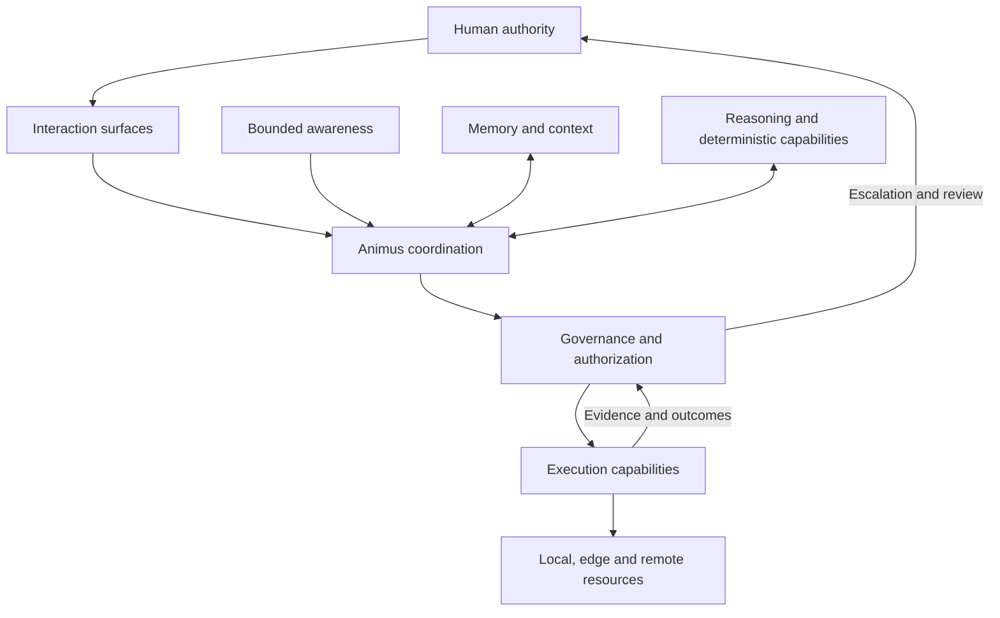

# Architecture Overview

> Animus is a local-first intelligent computing environment: a modular coordination layer for awareness, memory, reasoning, governance, and execution under human authority.

Linux is the supported public deployment target. Hardware, device, model, framework and OS independence are architectural objectives, not verified compatibility guarantees. Animus is not an operating system replacement.

## North Star and architectural boundaries

Ambient intelligence informs context-aware assistance and environmental awareness; edge AI informs where inference can run. Distributed systems inform resource coordination. None requires continuous inference or unrestricted autonomy.

The following is a target responsibility model, not a deployed topology or a replacement for existing package contracts.

| Responsibility | Current foundation | Target direction |
|---|---|---|
| Interaction | CLI, dashboard, early PWA, API | Consistent access and context across devices |
| Awareness | Health checks, citizen observations | Bounded event-driven observation and capability discovery |
| Memory | Core local JSON and configured durable SQL; package-specific stores | Portable context and continuity through explicit contracts |
| Reasoning | Provider dispatch, local and hosted inference | Resource-aware selection of deterministic or model-based capabilities |
| Coordination | Forge workflows and Quorum intent graphs | Interoperable routing across independently useful capabilities |
| Governance | Approval workflows, policy checks, evidence framework | Explicit authority, budgets, escalation and completion contracts |
| Execution | Existing Forge and Kernel mechanisms | Governed delegation to ForgeHand and other external executors |
| Infrastructure | Linux-first local deployment and optional hosted services | Authenticated heterogeneous edge and remote compute |

### Target responsibility flow



Observation, interpretation and action are separate responsibilities. Monitoring should use conventional event-driven mechanisms when sufficient; inference is invoked only when useful. External actions must be authorized within explicit scope. An executor must not grant itself permissions or unilaterally accept its own completion claims.

The standalone Loop Governor defines the intended authority boundary for delegated engineering work. [ForgeHand](https://github.com/AreteDriver/Forgehand-public) provides a complementary execution environment. Their integration into Animus must be verified before it is represented as operational. Forge (the existing workflow package) and ForgeHand are distinct components.

### Architectural constraints

- Consolidate existing capabilities before expanding the system.
- Reuse existing infrastructure and tools before creating replacements.
- Prefer narrow, versioned contracts over shared implementation assumptions.
- Local-first does not mean cloud-free; external processing requires explicit configuration and appropriate data-handling policy.
- Resource discovery must not imply trust: authenticate nodes and authorize capabilities before use.
- Preserve human authority, observability, recoverability and revocable permissions.
- Treat environmental awareness, portable deployment and distributed routing as research directions until validated.
- Existing accepted ADRs and package contracts remain authoritative; this overview does not supersede them.

The six-layer v2.3 Mind Foundation model below is retained as an existing conceptual view. It describes responsibilities, not proof that every named capability is implemented.

---

## System Diagram (v2.3)

```
┌─────────────────────────────────────────────────────────────┐
│                    Constitution Layer                         │
│   Sovereignty · Truth Baseline · Evidence Framework        │
│   Governance · Evaluation Standards · Kill Criteria        │
├─────────────────────────────────────────────────────────────┤
│                      Mind Layer                             │
│   Memory · Knowledge Graph · Ontology · Reasoning          │
│   Context · Learning · Research · Reflection              │
├─────────────────────────────────────────────────────────────┤
│                     Society Layer                           │
│   Phase 0 Citizens: Architect · Conversation Designer     │
│   Knowledge Curator · Test Oracle · (Future: G1–G4)        │
├─────────────────────────────────────────────────────────────┤
│                     Factory Layer                           │
│   Forge (orchestration) · Eval · Benchmarks · Testing      │
│   Evidence · Deployment · Quality Gates                    │
├─────────────────────────────────────────────────────────────┤
│                     Kernel Layer                              │
│   Scheduling · Resources · Persistence · Daemons           │
│   Networking · Resume · Sandbox                            │
├─────────────────────────────────────────────────────────────┤
│                   Infrastructure Layer                        │
│   CPU/GPU/NPU · Cloud · Clusters · Local-First Stack       │
└─────────────────────────────────────────────────────────────┘
```

*Historical architecture baseline dated 2026-07-05; not a fresh runtime verification. See [Package Architecture](packages.md) for dependency graph and version matrix.*

---

## Constitution Layer

Defines what Animus is allowed to do, how it measures truth, and who decides.

- **Sovereignty** — Human always owns the final decision. No autonomous action without approval gate.
- **Truth Baseline** — Claims require evidence. Every subsystem has an evidence manifest before promotion.
- **Evaluation Standards** — Deterministic scoring rubrics, failure taxonomy (technical + content), adversarial validation.
- **Governance** — Citizen Contract: citizens never modify code directly. Observe → Analyze → Propose → Human Approval → Forge → Evidence → Merge.
- **Kill Criteria** — Subsystems must prove themselves before promotion. See [Evidence Framework](#evidence-framework).

---

## Mind Layer

What makes it *yours* over time. Memory, knowledge, and reasoning.

### Memory

| Type | What it stores | Backend |
|---|---|---|
| **Episodic** | Conversations, events, decisions | Core local JSON / durable SQL |
| **Semantic** | Facts, preferences, relationships | Core local JSON / durable SQL |
| **Procedural** | Workflows, patterns, how you work | Core local JSON / durable SQL |
| **Reflection** | Feedback loop outcomes, improvement history | Package-specific stores |

**Implementation**: Core defaults to the local JSON backend and supports a
separately configured durable SQL backend. Its legacy Chroma adapter is retained
only for isolated migration verification and cannot be selected by `MemoryLayer`.
Other packages have separate backend contracts; their names must not be used as
Core `memory.backend` values.

### Identity

Defines *who* this Animus belongs to and what it cannot do.

- **Self** — The persistent identity file. What Animus calls itself, its values, its relationship to the user.
- **Persona** — Adjustable communication style (formal, casual, technical).
- **Core Values** — Immutable. Stored in `CORE_VALUES.md`. Cannot be modified by self-improvement.
- **Preferences** — Learned over time. Communication style, priorities, interaction patterns.

**Guardrails**: Small changes (<20% of file size) are written directly. Larger changes require dashboard approval. Safety rules are immutable — learned behavior cannot override them.

### Reasoning

- **Context Assembly** — Retrieves relevant memories, applies persona, assembles context envelope.
- **Learning** — Pattern detection from feedback, continuous model refinement.
- **Reflection** — Periodic self-review of decisions and outcomes.

---

## Society Layer

Long-lived specialist citizens that improve the Mind itself. Before domain citizens, Animus builds citizens that improve the system that produces value.

### Phase 0 — Mind Foundation Citizens

| Citizen | Role | Status |
|---|---|---|
| **001 — Architect** | Observes system behavior, detects technical debt, produces evidence-backed improvement proposals. | **Implemented** |
| **002 — Conversation Designer** | Reduces cognitive effort to use Animus. Detects repeated prompts, vague requests, correction loops. | **Implemented** |
| **003 — Knowledge Curator** | Maintains accuracy, detects drift, harvests cross-project patterns. | **Implemented** |
| **004 — Test Oracle** | Analyzes test suite health, coverage trends, eval drift. | **Implemented** |

### Citizen Contract

Citizens **never** modify code directly. The lifecycle:

```
Observe → Analyze → Propose → Human Approval → Forge → Evidence → Merge
```

- **ProposalQueue** — Approval lifecycle (DRAFT → SUBMITTED → APPROVED → COMMISSIONED → COMPLETE)
- **CitizenCouncil** — Collects, deduplicates, and ranks proposals from all citizens by priority score
- **Forge Commissioner** — Bridges approved proposals to Forge workflows

### Generational Roadmap

- **G1** — Mind Foundation (Architect, Conversation Designer, Systems Engineer, etc.)
- **G2** — Research Foundation (Distributed Systems, OS, AI, Databases, Networking, Compilers)
- **G3** — Domain Specialists (Medicine, Finance, Manufacturing, etc.)
- **G4** — Personal Citizens (Health, Learning, Writing, Calendar, etc.)

---

## Factory Layer

The autonomous builder engine. Evaluation, orchestration, and quality gates.

### Forge

Multi-agent workflow orchestration (`animus_forge`). Define pipelines in YAML, assign per-agent token budgets, set quality gates, and persist stage state to SQLite for manual restart; automatic context-restoring recovery remains incomplete.

- **10 agent archetypes**: researcher, reviewer, writer, tester, security, etc.
- **Budget controls**: Every agent has a token ceiling. Every workflow has a cost cap.
- **Checkpoint/resume**: Persisted stages support manual restart at a selected step; automatic recovery requires separate validation.
- **Quality gates**: Threshold checks after each stage. Failures trigger rollback or retry.

### Evaluation

- **Eval Calibration** — Periodic A/B runs against rubrics to detect model drift.
- **Truth Baseline** — 8-point validation script verifying schema, imports, and critical paths.
- **Failure Taxonomy** — Two orthogonal classifiers: technical (schema_drift, hallucination, etc.) and content (missing_constraint, weak_evidence, etc.).

---

## Kernel Layer

Scheduling, resources, persistence, and safety.

- **Budget Manager** — Token accounting, spend tracking, cost ceiling enforcement.
- **Executor** — Runs workflow steps, handles async DAG scheduling.
- **Sandbox** — Validates changes before application. Test-driven safety.
- **Safety Checks** — Config validation, guardrail enforcement, forbidden skill blocking.
- **Resume** — State persistence to SQLite. Workflow recovery on failure.

The Kernel was extracted from Forge for standalone use (`packages/kernel/`).

---

## Infrastructure Layer

Where Animus runs. Linux-first today; hardware independence is a target.

| Integration | Purpose | Status |
|---|---|---|
| **CLI** | Interactive agent with memory, streaming, tool use | Active |
| **Bootstrap Dashboard** | FastAPI+HTMX ops UI (`localhost:7700`) | Active |
| **MCP Server** | Tools exposed through MCP; consult current server registration for inventory | Active |
| **Ollama** | Local LLM inference | Active |
| **Anthropic / OpenAI** | Cloud LLM APIs | Optional |
| **Filesystem** | Local file access | Active |
| **Calendar / Tasks** | Google Calendar, Todoist | Active |

**Local-first by default.** Prefer locally controlled memory and computation; review configured integrations and data egress.

---

## Evidence Framework

> "Documented but unverified" is not enough. Every claim needs inspectable evidence.

**Feature Maturity Stages:**

| Stage | Name | What it means |
|---|---|---|
| 0 | Concept | Design doc exists |
| 1 | Scaffolded | Code structure in place |
| 2 | Implemented | Logic complete, compiles/runs |
| 3 | Tested | Unit/integration tests pass |
| 4 | Validated | Evaluated against rubric |
| 5 | Verified | Adversarial review passed |
| 6 | Self-improving | Citizens actively improve it |

**Evidence Coverage KPI** — Percentage of claims with matching evidence. Target: 100% before promotion.

---

## Data Flow

### Standard Interaction

```
User input (CLI / Dashboard / MCP)
         │
         ▼
┌─────────────────────┐
│   Constitution      │  ← Load values, apply guardrails
│   (Identity)        │
└─────────────────────┘
         │
         ▼
┌─────────────────────┐
│   Mind Layer        │  ← Retrieve context, assemble envelope
│   (Memory + Reason) │
└─────────────────────┘
         │
         ▼
┌─────────────────────┐
│   Factory Layer     │  ← Forge/Quorum reason, generate
│   (Cognitive)       │
└─────────────────────┘
         │
         ▼
┌─────────────────────┐
│   Mind Layer        │  ← Store new context, update patterns
│   (Memory)          │
└─────────────────────┘
         │
         ▼
┌─────────────────────┐
│   Infrastructure    │  ← Deliver response
│   (Interface)       │
└─────────────────────┘
```

### Self-Improvement Flow

```
Feedback / Citizen Proposal
         │
         ▼
┌─────────────────────┐
│   Society Layer     │  ← Analyze, generate proposal
│   (Citizens)        │
└─────────────────────┘
         │
         ▼
┌─────────────────────┐
│   Constitution      │  ← Human approval gate
│   (Governance)      │
└─────────────────────┘
         │
         ▼
┌─────────────────────┐
│   Factory Layer     │  ← Forge executes workflow
│   (Sandbox)         │
└─────────────────────┘
         │
         ▼
┌─────────────────────┐
│   Evidence          │  ← Tests, evals, adversarial review
│   (Validation)      │
└─────────────────────┘
         │
         ▼
┌─────────────────────┐
│   Merge             │  ← Commit with evidence
└─────────────────────┘
```

---

## Security Model

### Threat Model

| Threat | Mitigation |
|---|---|
| Unauthorized config access | Config files chmod 600 |
| Malicious self-modification | Approval gate for >20% file changes |
| Data exfiltration | Local-first by default; no telemetry |
| Model prompt injection | Guardrails, input sanitization |
| API key leakage | Restrict credential access; provider authentication transmits credentials to configured endpoints as required |
| Citizen override | Citizen Contract forbids direct modification |

### Privacy design objectives

1. **No telemetry without consent** — Verify telemetry behavior for the deployed configuration
2. **Local memory** — Core local JSON on your machine, or durable SQL when
   explicitly configured
3. **Explicit sharing only** — External processing and integrations require explicit configuration and appropriate egress controls
4. **Audit trail** — Record inspectable events and outcomes; validate coverage

See [Reference → Security](../reference/security.md) for full threat model.

---

## Extensibility

### Plugin Architecture

Animus supports extensions for:
- Additional memory backends
- Custom tool integrations
- New agent archetypes in Forge
- Specialized cognitive modules
- New Citizens (following the Citizen Contract)

### API Layer

RESTful API on port 8000 (Forge service):
- Workflow submission and monitoring
- Memory read/write
- Task and feedback management
- MCP tool execution

API exposure must be configured with appropriate authentication and guardrails; verify enforcement before remote deployment.

---

## Design Principles

**Sovereignty-first.** Human owns every decision. Citizens propose; humans approve. No exceptions.

**Evidence before action.** Every claim needs evidence, expected benefit, risks, and success metrics. See [Evidence Framework](#evidence-framework).

**Budget-first execution.** Every agent has a token budget. Every workflow has a cost ceiling. Inspired by Toyota Production System — make cost visible, make waste impossible to ignore.

**Consolidation before expansion.** Validate improvements against evidence before increasing autonomy or expanding citizen capabilities.

**Checkpoint/resume.** All Forge workflows persist state to SQLite. If a pipeline fails at step 4 of 6, it restarts at step 4. Recovery reduces unnecessary repeated work but does not eliminate it.

**Provider-agnostic.** LLM calls go through a shared interface. Swap Claude for OpenAI or Ollama without touching agent code.

**Local-first.** Prefer locally controlled memory and computation; review configured integrations and data egress.

---

## See Also

- [Package Architecture](packages.md) — Dependency graph and version matrix
- [Citizen Zero](citizen-zero.md) — First citizen specification
- [Decisions](decisions/README.md) — Architecture Decision Records (ADRs)
- [Reference → Glossary](../reference/glossary.md) — Domain terms
- [Roadmap](../roadmap/current.md) — Future plans
